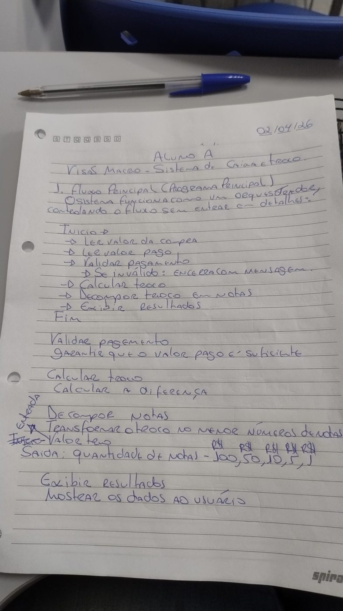
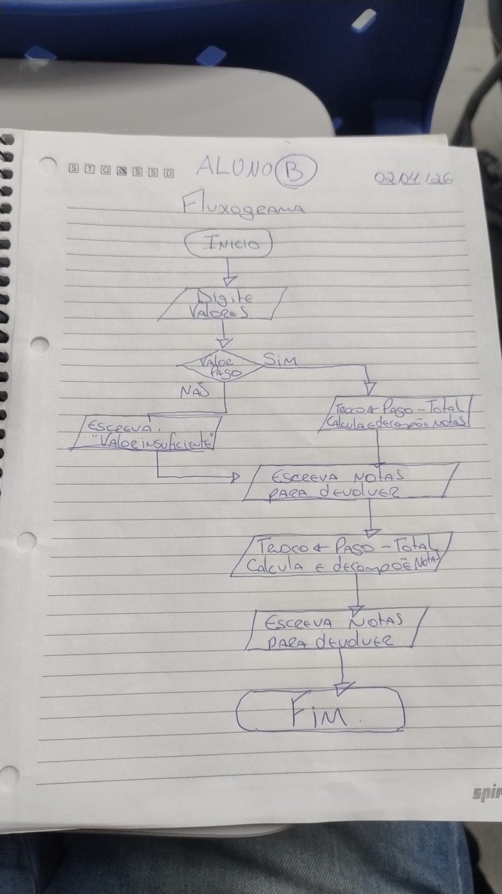
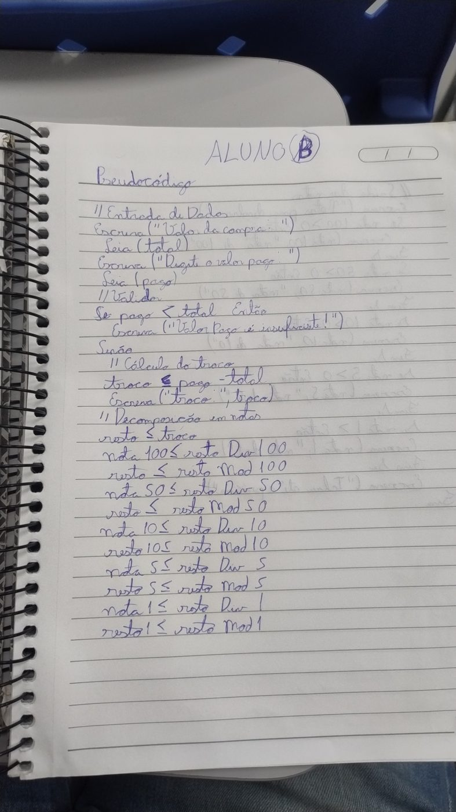
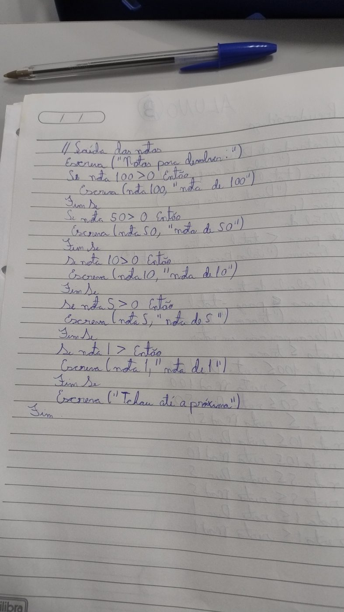

# Sistema de Caixa: Troco com Menos Cédulas

Exercício de **modularização** da disciplina de Programação de Computadores (Análise e Desenvolvimento de Sistemas, Unicid), que divide o trabalho em dois papéis: o "Aluno A" define a visão geral do sistema em módulos, e o "Aluno B" detalha esses módulos em fluxograma e pseudocódigo.

## O problema

Um caixa recebe o valor da compra e o valor pago pelo cliente. Ele deve:

1. validar se o pagamento é suficiente e, se não for, encerrar com uma mensagem;
2. calcular o troco (`troco = valor pago - valor da compra`);
3. decompor o troco no **menor número de cédulas** de R$ 100, 50, 10, 5 e 1;
4. mostrar quantas cédulas de cada valor devem ser entregues.

## Visão geral em módulos (Aluno A)



## Fluxograma (Aluno B)



## Pseudocódigo (Aluno B)

 

O núcleo da decomposição usa divisão inteira (`Div`) e resto (`Mod`):

```pascal
nota100 <- resto Div 100
resto   <- resto Mod 100
nota50  <- resto Div 50
resto   <- resto Mod 50
// e assim por diante para 10, 5 e 1
```

## Conceitos praticados

- Modularização: dividir um problema em partes menores e independentes
- Validação de entrada antes do processamento
- Operadores `Div` (quociente) e `Mod` (resto)

[⬅ Voltar ao portfólio](../)
